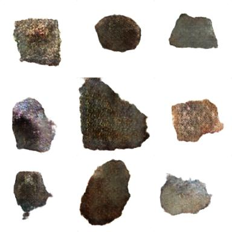

# Yuchen Li

I am an undergraduate at Southern University of Science and Technology
(SUSTech), pursuing a Bachelor of Science in **Data Science and Big Data
Technology**.

My work spans data analysis, machine learning, and analytical systems, with
an emphasis on reproducible experiments and clearly scoped contributions.
I am preparing for Master's study in Hong Kong and Singapore and exploring
internship opportunities.

[中文简介](zh.html) · [GitHub](https://github.com/0zz0ruby) ·
[Email](mailto:lyclyc555@126.com)

## Technical skills

- **Programming:** Python, SQL, Java
- **Data analysis:** Pandas, NumPy, SciPy
- **Machine learning:** Scikit-learn, PyTorch, reinforcement learning, model validation
- **Visualization:** Matplotlib, Seaborn
- **Statistics:** hypothesis testing, multivariate analysis, simulation
- **Data systems:** Hadoop, HDFS, MapReduce

## Featured projects

### 1. DataAgent-SFT

Curated data-analysis trajectories and fine-tuned the text backbone of
Qwen3.5-0.8B to generate structured analysis plans and Python code.
CrossMetric AI applies the fine-tuned Data Agent in a commerce-analysis prototype.

**Highlights:** selected 2,500 trajectories from 11,707 inputs; used a
group-disjoint 2,000/500 train-validation split; reduced held-out token loss
from 0.731607 to 0.488760.

[View project details](projects/data-agent-sft.html) ·
[Source code](https://github.com/0zz0ruby/data-agent-sft)

### 2. Meteorite Vision

Studied meteorite classification under train/test domain shift and independently
developed a DCGAN/WGAN-GP image-generation pipeline. My classification work
covered the ResNet-18 baseline, DINOv2 experiments, external-image processing,
and the proposal to use voting ensembles.

**Highlights:** individual online F1 of 0.73; a preserved team ensemble
configuration scored 0.78260, with a separately recorded final team score of
0.78284; final saved generation FID of 134.20.

[View project details](projects/meteorite-vision.html) ·
[Source code](https://github.com/0zz0ruby/meteorite-vision-portfolio) ·
[Kaggle Stage 2](https://www.kaggle.com/competitions/meteorite-identification-stage-2)

### 3. LOB Factor Calculation with Hadoop MapReduce

First built and validated a two-job calculation pipeline, then investigated its
runtime bottlenecks and redesigned it as a single MapReduce job. The
optimization reduces task-scheduling and intermediate-data overhead through
complete-file input combining and Mapper-side aggregation.

**Highlights:** 20 factors across approximately 1,500 stock files and five trading
days; all factors passed the 1% mean-relative-error threshold on each day;
the single-job pipeline averaged 16.8 seconds per day.

[View project details](projects/lob-factor-mapreduce.html) ·
[Source code](https://github.com/0zz0ruby/lob-factor-mapreduce)

### 4. CartPole Reinforcement Learning and Robustness

Optimized A2C/PPO hyperparameters and designed an Energy-Aware Force-Split
Independent PPO controller, separating direction from 11-level force control.
The later confirmatory study uses 10 training seeds and a fixed interaction
budget.

**Highlights:** both A2C and PPO reached approximately the 500-step cap;
PPO's learning-curve AUC was 15.2% higher; the Force-Split penalty reduced
the force-squared control-cost proxy by 93.58%, without establishing unchanged
control performance.

[View project details](projects/cartpole-energy-aware-marl.html) ·
[Source code](https://github.com/0zz0ruby/cartpole-energy-aware-marl)

### 5. Credit Card Customer Segmentation

Built an end-to-end customer segmentation workflow using 17 behavioral
features from 8,950 credit card customers. The project combines PCA,
K-means clustering, non-parametric statistical testing, discriminant analysis,
and Monte Carlo simulation to identify interpretable customer groups and
translate them into marketing and risk-management recommendations.

**Highlights:** 5 principal components retained 70.13% of total variance;
four customer segments were selected by balancing internal clustering metrics
with business interpretability; 240 simulation runs evaluated robustness across
sample sizes and noise levels.

[View project details](projects/credit-card-customer-segmentation.html) ·
[Source code](https://github.com/0zz0ruby/credit-card-customer-segmentation)

## Contact

- Email: [lyclyc555@126.com](mailto:lyclyc555@126.com)
- GitHub: [@0zz0ruby](https://github.com/0zz0ruby)
