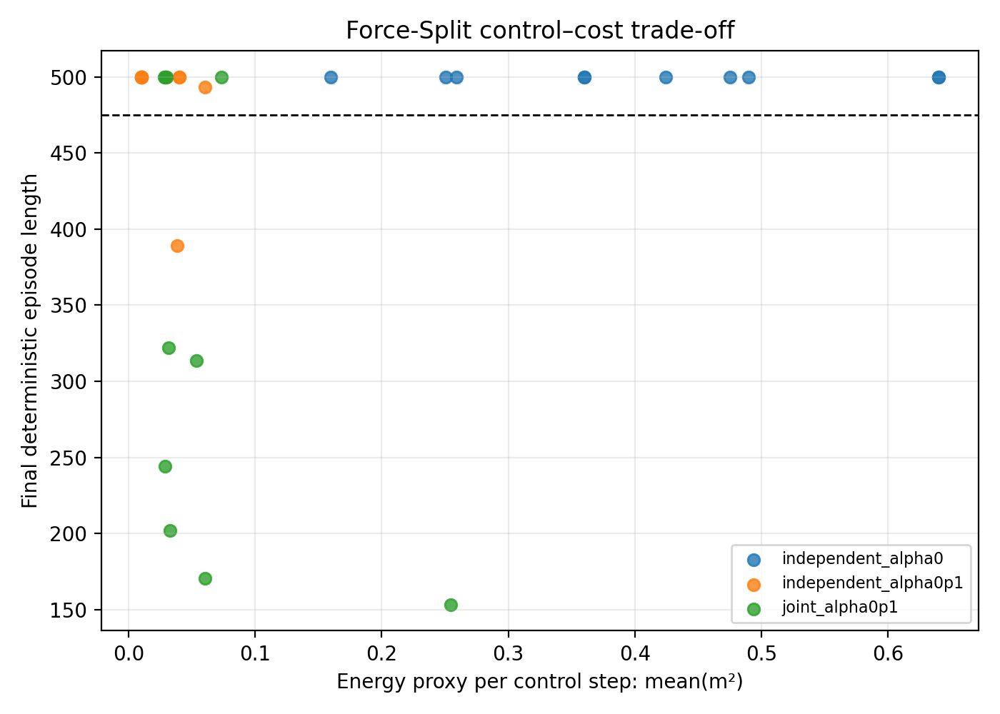
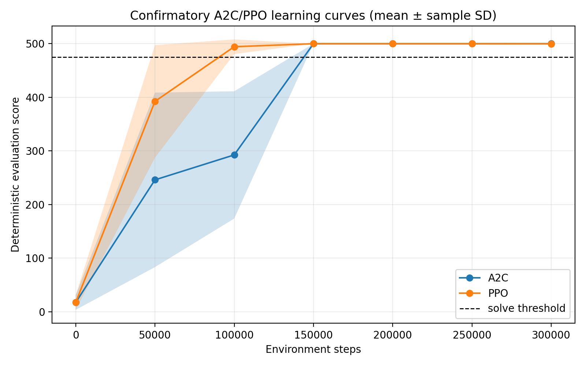
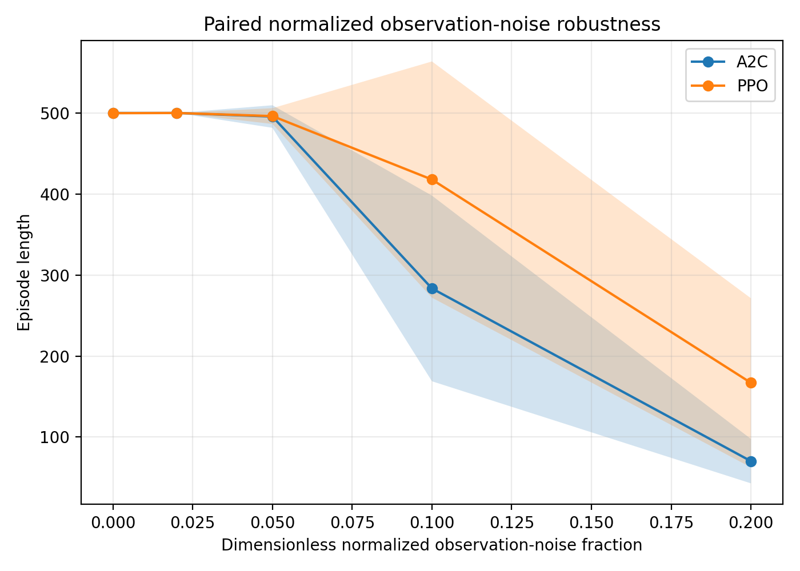

# CartPole Reinforcement Learning and Robustness

**Three-member team project | Python, PyTorch, Gymnasium, NumPy, Matplotlib**

[Back to portfolio](../)

[Browse source code](https://github.com/0zz0ruby/cartpole-energy-aware-marl) ·
[Read the full report](https://github.com/0zz0ruby/cartpole-energy-aware-marl/blob/main/report/FinalReport.pdf)

## Project overview

This three-member team project studies reinforcement and imitation learning on
Gymnasium's CartPole-v1. The earlier DQN/A2C/PPO/BC baselines and later
confirmatory A2C/PPO, Force-Split, and noise studies use different protocols
and are reported separately.

## My contribution

- Optimized A2C and PPO hyperparameters through sensitivity analysis and grid
  search over learning rate, entropy coefficient, and clipping range.
- Designed `ForceSplitCartPole`, which decomposes the original binary action
  into direction selection and 11-level force-magnitude control.
- Implemented an energy-aware cooperative two-agent PPO controller and studied
  the trade-off between episode stability and average actuation force.

## Confirmatory experiment design

The later study uses 10 independently trained seeds, exactly 300,000 training
environment transitions per seed, deterministic evaluation every 50,000
transitions, and a 100-episode final evaluation. Results report seed-level means
and sample standard deviations, with paired bootstrap confidence intervals from
20,000 resamples.

Termination and time-limit truncation are handled separately. PPO also updates
from its final partial rollout.

[Protocol](https://github.com/0zz0ruby/cartpole-energy-aware-marl/blob/main/experiments/PROTOCOL.md) ·
[Contribution statement](https://github.com/0zz0ruby/cartpole-energy-aware-marl/blob/main/CONTRIBUTIONS.md)

## Energy-aware Force-Split control

The direction agent chooses left or right, while the magnitude agent chooses
one of 11 normalized force levels. Both policies observe the same state and
receive the same cooperative reward:

```text
r = 1 - alpha * m^2
```

where `m` is normalized force magnitude. This is Independent PPO, not MAPPO:
there is no centralized critic.

| Group | Episode steps | Force-squared proxy per step |
|---|---:|---:|
| Independent PPO, alpha=0 | 500.00 ± 0.00 | 0.4059 ± 0.1606 |
| Independent PPO, alpha=0.1 | 488.27 ± 34.85 | 0.0259 ± 0.0183 |

The penalty reduced the paired force-squared proxy by **93.58%**, with a
bootstrap 95% confidence interval of [91.40%, 95.61%]. The step-difference
interval [-33.88, 0.00] crossed the predeclared −25-step non-inferiority margin,
so unchanged control performance was not established. The quantity is a
control-cost proxy, not calibrated physical energy.



## A2C versus PPO

| Metric | A2C | PPO |
|---|---:|---:|
| Final score | 500.00 ± 0.00 | 499.83 ± 0.55 |
| Normalized learning-curve AUC | 0.7657 ± 0.0550 | 0.8818 ± 0.0345 |
| Sustained solve step | 195k ± 15.8k | 145k ± 28.4k |
| Solved seeds | 10/10 | 10/10 |

The paired PPO−A2C AUC difference was 0.1161, with a 95% confidence interval
of [0.0749, 0.1524], a relative increase of 15.2%. Both reach approximately
the 500-step ceiling. The evidence supports faster PPO learning under this
budget, not superior final performance.



## Observation-noise robustness

Gaussian noise is applied after scaling each state coordinate by a documented
reference range. This is a synthetic stress test, not a calibrated sensor model.

| Noise fraction | A2C score | PPO score |
|---|---:|---:|
| 0.00 | 500.00 | 499.75 |
| 0.02 | 500.00 | 499.99 |
| 0.05 | 495.60 | 496.16 |
| 0.10 | 283.44 | 417.83 |
| 0.20 | 70.27 | 166.94 |

At 10% noise, PPO's mean score declined 16.4% relative to its clean score,
versus 43.3% for A2C. The paired robustness-AUC difference was 0.1493,
with a 95% confidence interval of [0.0639, 0.2272].



## What I learned

This project showed that a saturated benchmark score can conceal meaningful
differences in training stability and robustness. It also demonstrated how
action decomposition and reward shaping can turn a simple control benchmark
into an interpretable cooperative-learning problem with an explicit
control-performance and control-cost trade-off.

## Scope and limitations

- The Force-Split implementation uses independent PPO policies with a shared
  reward, not a centralized critic.
- The earlier team study used five repeated 100-episode evaluations. Those
  historical results are not pooled with the later 10-seed study.
- DQN, BC, and DAgger are team components unless explicitly identified otherwise
  in the contribution statement.
- Frozen confirmatory dependencies, seed-level data, evaluation scripts, and
  statistical reports are available in the source repository.

